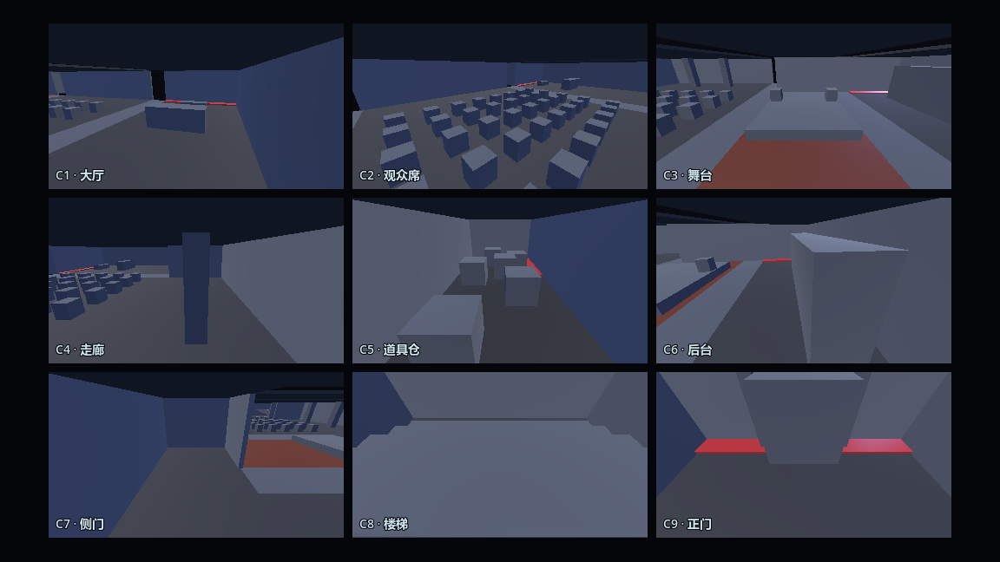
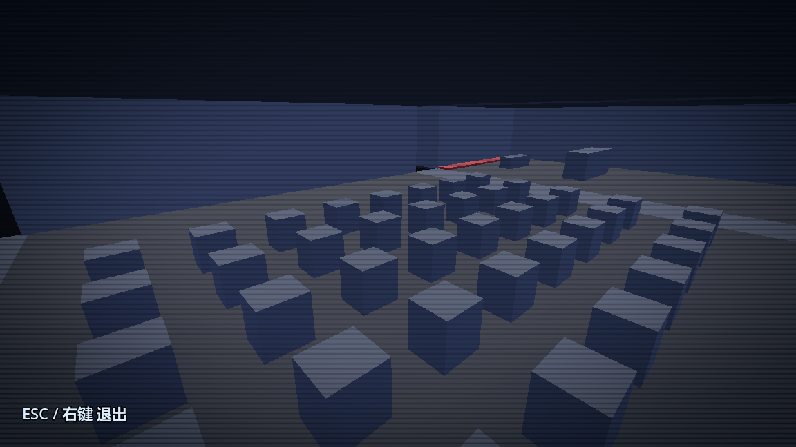
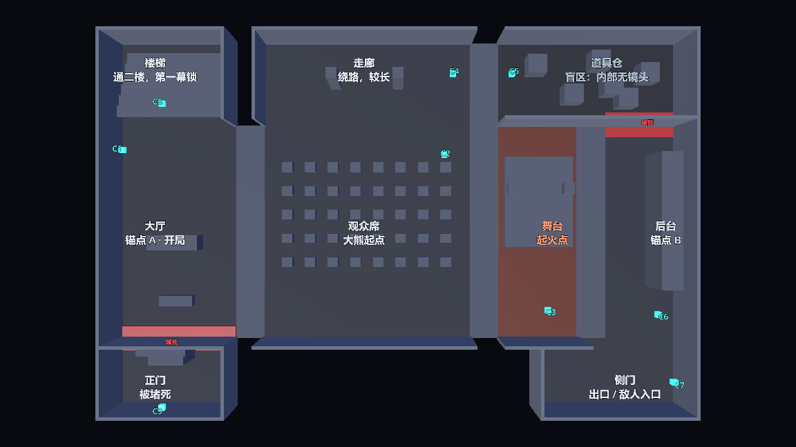
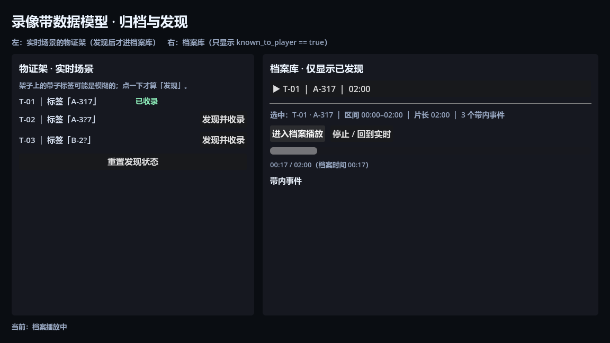
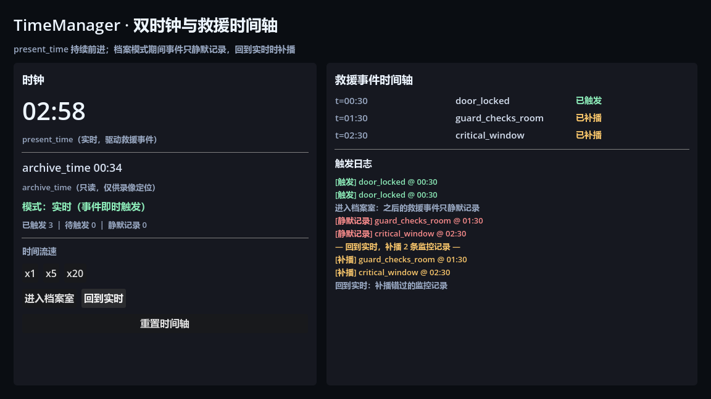
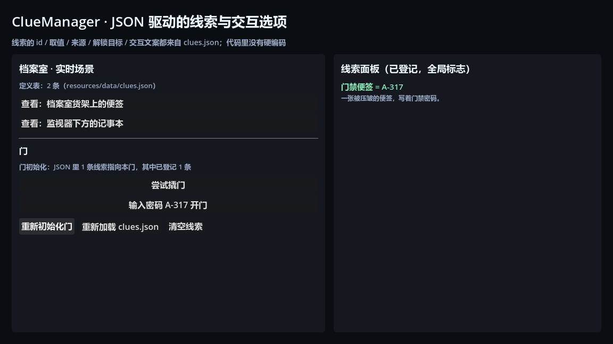

# Godot Trail

Godot 4.7 的「2D UI 承载 3D SubViewport」演示项目：监控器网格、全屏锁定过渡、剧院平面地图与 9 路监控墙。当前为 **占位美术阶段**，重点在结构、过渡手感与数据驱动的地图/机位。

---

## 环境

| 项 | 值 |
|---|---|
| 引擎 | Godot 4.7.x（开发验证于 4.7.2 stable） |
| 语言 | GDScript（本项目不含 C#） |
| 渲染 | Forward+ |
| 平台 | 桌面（Windows 验证） |

## 快速开始

用 Godot 打开本目录（含 `project.godot`）即可。命令行方式：

```bash
# 运行 9 路监控墙
godot --path . scenes/theater_monitor.tscn

# 运行剧院平面图（俯视）
godot --path . scenes/theater_map.tscn

# 运行 4 路网格演示
godot --path . scenes/monitor_grid_demo.tscn

# 三个系统 demo
godot --path . scenes/demo_tapes.tscn           # 录像带数据模型 + 归档/播放
godot --path . scenes/demo_time_manager.tscn    # 双时钟 + 救援事件时间轴
godot --path . scenes/demo_clues.tscn           # 全局线索 + 初始化时决定选项

# 冒烟测试（无窗口）
godot --headless --path . --script tests/smoke_test.gd

# 无窗口跑场景 40 帧（检查脚本是否报错）
godot --headless --path . --quit-after 40 scenes/theater_monitor.tscn
```

> 所有路径均为相对项目根的路径；仓库内不保存任何机器相关的绝对路径。

## 场景一览

| 场景 | 内容 | 交互 |
|---|---|---|
| `scenes/main.tscn` | 最小基线（打印就绪标记） | 无 |
| `scenes/monitor_grid_demo.tscn` | 4 个 SubViewport 立方体网格 + 全屏锁定过渡 | 点击格子进入；`ESC` / 右键返回 |
| `scenes/theater_map.tscn` | 剧院俯视平面占位图：9 房间、通道/堵死、C1–C9 机位 | 无（用于检查布局与机位） |
| `scenes/theater_monitor.tscn` | 9 路 3×3 监控墙（数据来自剧院地图） | 点击某一路全屏；`ESC` / 右键返回 |
| `scenes/demo_tapes.tscn` | 录像带数据模型：物证架发现 → 档案库筛选 → 播放定位 | 点击「发现并收录」「进入档案播放」「停止」 |
| `scenes/demo_time_manager.tscn` | 双时钟 + 救援事件时间轴 + 档案期间静默记录 | 「进入档案室 / 回到实时」、时间流速 x1/x5/x20 |
| `scenes/demo_clues.tscn` | 全局线索：登记后交互节点重新初始化才显示新选项 | 「查看便签」「重新初始化门」「清空线索」 |

### 剧院平面（theater_map）

```
楼梯 ── 大厅 ── 观众席 ── 舞台 ── 后台
		  │        │                   │
		正门(堵死) 走廊 ── 道具仓      侧门(出口)
```

- 单位：米（`1 unit = 1 m`），x 向东、z 向南、y 向上
- 9 个房间：楼梯、走廊、道具仓（盲区）、大厅（锚点 A）、观众席、舞台（起火点）、后台（锚点 B）、正门（堵死）、侧门
- 9 个机位：C1 大厅、C2 观众席、C3 舞台、C4 走廊、C5 道具仓门口、C6 后台、C7 侧门、C8 楼梯、C9 正门
- 房间/通道/机位全部由 `ROOMS` / `LINKS` / `CAMERAS` 三张常量表驱动，改布局只改表

### 监控墙（theater_monitor）

- 每路一个 `SubViewport`（共享同一 3D 世界，复制地图机位的变换）
- 3×3 网格，格子 16:9，居中排布
- 点击 → 全屏层淡入 + `ZoomCamera` 从机位后撤 2 m 推近 → `FOCUSED`，叠加扫描线/暗角
- `ESC` / 右键 → 反向过渡回到网格
- 过渡期间（`TRANSITION_IN` / `TRANSITION_OUT`）屏蔽所有输入，避免中途切换

状态机：

```
GRID ──点击──▶ TRANSITION_IN ──完成──▶ FOCUSED
 ▲                                      │
 └────────── GRID ◀──完成── TRANSITION_OUT ◀──ESC/右键
```

## 系统演示（三个 demo）

三套系统都是「autoload 脚本 + demo 场景」，autoload 在 `project.godot` 里注册，demo UI 均在运行时构建。

### 1. 录像带数据模型（`scenes/demo_tapes.tscn`）

- `scripts/tapes/tape_resource.gd` —— `class_name TapeResource extends Resource`
  - 字段：`tape_id`、`label`（玩家可见，可能模糊/错误）、`time_start`、`time_end`、`stream: VideoStream`、`event_timeline: Array[Dictionary]`、`known_to_player`
  - `duration()` / `contains_time()` / `events_between(from, to)`（带内相对秒）
- `scripts/tape_archive.gd` —— autoload `TapeArchive`：`load_default_library()`、`get_known_tapes()`、`discover(tape_id)`、`reset_discovery()`
- 数据文件：`resources/tapes/*.tres`（T-01 标签清晰、T-02/T-03 标签模糊）
- 档案库只显示 `known_to_player == true` 的带子；在「物证架」点「发现并收录」才进列表

### 2. 时间管理器（`scenes/demo_time_manager.tscn`）

- `scripts/time_manager.gd` —— autoload `TimeManager`
  - `present_time` 实时推进；`archive_time` 只读（只有 `enter_archive` / `seek_archive` 能改）
  - `rescue_events` 时间轴数组，越过阈值统一分发，不在 `_process` 里散落条件
  - 档案模式下事件静默记入 `deferred_events`，`exit_archive()` 时以 `deferred = true` 补播并发出 `deferred_events_flushed`
- 默认时间轴：`door_locked @30s`、`guard_checks_room @90s`、`critical_window @150s`
- demo 提供时间流速 x1 / x5 / x20 便于观察

### 3. 线索管理器（`scenes/demo_clues.tscn`）

线索**不再是代码里的常量**，而是由 JSON 定义表驱动：

```json
// resources/data/clues.json
{
  "version": 1,
  "clues": [
    {
      "id": "door_code_A",
      "title": "门禁便签",
      "value": "A-317",
      "source": "档案室货架上的便签",
      "description": "一张被压皱的便签，写着门禁密码。",
      "unlocks": "door_archive",
      "action": "输入密码 {value} 开门"
    }
  ]
}
```

| 字段 | 用途 |
|---|---|
| `id` | 线索唯一标识，运行时 `has_clue(id)` 用 |
| `value` | 登记时的默认取值 |
| `source` / `description` | demo 里「线索来源」按钮与线索面板展示 |
| `unlocks` | 该线索解锁哪个交互（demo 的门 id 为 `door_archive`） |
| `action` | 交互按钮文案模板，`{value}` 会被替换 |

`scripts/clue_manager.gd`（autoload `ClueManager`）：

| 方法 | 说明 |
|---|---|
| `load_definitions(path = DEFAULT_DEFINITIONS_PATH)` | 载入/重载 JSON 定义表，失败发 `definition_error` |
| `get_definitions()` / `get_definition(id)` | 定义查询 |
| `get_definitions_for_unlock(unlock_id)` | 某交互可用的线索定义 |
| `register_clue(id, value = null)` | 登记线索；`value` 省略时取 JSON 里的 `value` |
| `has_clue(id)` / `get_clue(id)` / `get_all()` / `clear()` | 运行时状态 |
| `build_action_text(id)` | 用 `action` 模板生成按钮文案 |

交互节点在**初始化时**读一次 `has_clue()` 决定显示哪些选项；登记新线索后需重新初始化（demo 里是「重新初始化门」）。

**改数据不用改代码**：把 `clues.json` 的 `value` 改成别的值，点「重新加载 clues.json」→ 线索取值与按钮文案立刻跟着变。

## 目录结构

```
project.godot
scenes/
  main.tscn                  # 基线
  monitor_grid_demo.tscn     # 4 路网格演示
  theater_map.tscn           # 剧院平面图
  theater_monitor.tscn       # 9 路监控墙
  demo_tapes.tscn            # 录像带数据模型 demo
  demo_time_manager.tscn     # 双时钟 demo
  demo_clues.tscn            # 线索 demo
scripts/
  main.gd
  monitor_grid_demo.gd       # 4 路网格控制器
  theater_map.gd             # 地图构建器（房间/通道/机位/道具）
  theater_monitor.gd         # 9 路监控墙控制器
  time_manager.gd            # autoload：双时钟 + 救援事件时间轴
  clue_manager.gd            # autoload：JSON 驱动的线索
  tape_archive.gd            # autoload：磁带库
  tapes/tape_resource.gd     # TapeResource 数据模型
  demos/demo_tapes.gd
  demos/demo_time_manager.gd
  demos/demo_clues.gd
  demo_ui.gd                 # demo 用 UI 小工具
resources/
  tapes/*.tres               # 磁带资源
  data/clues.json            # 线索定义表
shaders/
  grid_ground.gdshader       # 地面网格
  scanline_vignette.gdshader # 扫描线 + 暗角
tests/
  smoke_test.gd              # 冒烟测试
manifests/asset_manifest.json
external-assets/             # 大体积资源目录（内容不入库）
docs/screenshots/            # README 用截图
```

> `autoload/mcp_interaction_server.gd` 不在此列：它由 godot-bridge 在本机调试时自动注入，带本地 eval 能力，已加入 `.gitignore`。

## 常用 API

`theater_map.gd`（挂在 `theater_map.tscn` 根节点）：

| 方法 | 返回 |
|---|---|
| `get_camera_nodes()` | `{ "C1": Node3D, ... }` 机位挂点（子节点 `Camera3D` 提供变换） |
| `get_map_summary()` | 房间数、机位列表（id / 房间 / 位置 / fov）、盲区房间、平面尺寸 |
| `get_room_names()` | 房间 id 列表 |
| `get_room_display_name(room_id)` | 房间中文名 |

`theater_monitor.gd` / `monitor_grid_demo.gd`（挂在各自根节点）：

| 方法 | 返回 |
|---|---|
| `get_state_name()` | `"GRID"` / `"TRANSITION_IN"` / `"FOCUSED"` / `"TRANSITION_OUT"` |
| `get_focus_snapshot()` | 当前状态、激活机位、图层可见性/alpha、相机位置与 fov 等 |

信号：`focus_changed(new_state: int)`。

三套系统（录像带 / 时间 / 线索）的 API 见上文「系统演示」一节。

## 可调参数

`theater_monitor.gd`：

| 参数 | 默认 | 说明 |
|---|---|---|
| `transition_duration` | 0.45 | 过渡时长（秒） |
| `transition_pull_back` | 2.0 | 进场时机位后撤距离（米） |
| `transition_fov_widen` | 1.08 | 进场起始 FOV 倍数 |
| `show_scanline_overlay` | true | FOCUSED 时叠加扫描线/暗角 |

`theater_map.gd`：`CAMERA_HEIGHT`（机位高度）、`WALL_HEIGHT`（墙高）、`CEILING_LAYER`（天花板渲染层）。

## 测试

`tests/smoke_test.gd` 校验 `application/run/main_scene` 已配置、可加载、可实例化，退出码 0/1：

```bash
godot --headless --path . --script tests/smoke_test.gd   # 期望输出 SMOKE_TEST_PASS
```

## 资产

- 大体积资源放 `external-assets/`，内容不纳入版本库（见 `.gdignore` 与 `.gitignore`）
- 资产清单：`manifests/asset_manifest.json`

## 截图













## 已知限制

- 美术全部为占位方盒，无贴图/材质细节
- `theater_map` / `theater_monitor` 的节点由脚本在运行时生成，编辑器里需运行后才能看到完整结构
- 地图与监控墙之间目前是「复制机位变换」，尚未做真正的画面串流/录制
- 三个系统 demo 的 UI 也是运行时构建的，场景文件里只有根节点
- 磁带 `stream` 字段暂未接真实视频，只用 `event_timeline` 驱动播放定位
- `clues.json` 用 `FileAccess` 直读；若要导出发行版，需确认 JSON 被打包（或改用 JSON 资源加载）
- 调试用的 `autoload/mcp_interaction_server.gd` 不入库（带本地 eval，公开仓库不应携带）；用 godot-bridge 跑一次项目会临时注入

更多踩坑记录与约定见 [MEMORY.md](MEMORY.md)。
